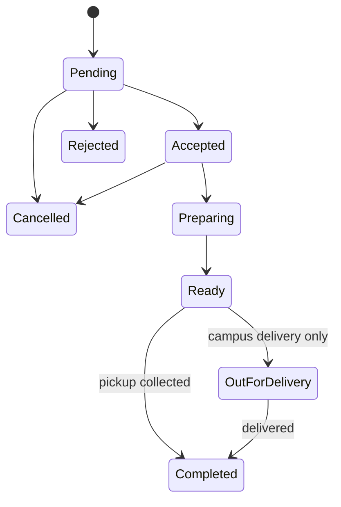

# Architecture and design

## Context and components

The system uses a browser client, JSON REST API, relational database, and private document storage. The API is the authority for authorization and business rules. An approved vendor is visible to student catalogue queries; vendor status is rechecked during cart updates and checkout. Financial payment is outside scope.

| Component | Responsibility |
|---|---|
| React/Vite browser | Marketplace, cart, student/vendor/admin workspaces, form feedback |
| FastAPI routes | Authentication, role policy, validation, business workflows, summaries |
| SQLAlchemy models | Relational users, vendors, applications, listings, carts, orders, history and notifications |
| SQLite/PostgreSQL | Durable relational records; selected by `DATABASE_URL` |
| Private upload directory | Randomized file keys; admin-only document endpoint |

## Data model

The full entity-relationship diagram is in [`diagrams/ER.md`](diagrams/ER.md); data flows are in [`diagrams/DFD.md`](diagrams/DFD.md).

`User` has a single role. A vendor user owns one `Vendor`; a vendor has one application and many products. `Cart` is unique per student and holds one nullable `vendor_id`; `CartItem` is unique by cart/product. `Order` records student, vendor, status, delivery snapshot and subtotal. `OrderItem` snapshots product name/price/quantity. `ApprovalHistory` stores admin, vendor, optional application, action, decision, remarks and timestamp. Notifications are per-recipient. Audit logs record actor and entity.

## Order lifecycle

Campus delivery orders can also carry a `delivery_stage` (`main_gate` or `hostel_gate`) when the vendor announces arrival at a gate. Students see these states as a step tracker on **Your orders** (placed, accepted, being prepared, packed or ready for pickup, on the way, at the gate, delivered or collected); finished, cancelled and rejected orders move to **Order history**.

Cancellation is permitted only while pending or accepted. Cancelled quantities are returned to stock. Vendor status is checked before updates; a stopped vendor cannot manage orders. No payment or delivery fee is calculated.

## Security boundary

Every non-public API uses a signed, expiring bearer token and loads the current enabled user. Role dependencies gate dashboards. Student order queries filter by student ID; vendor listing/order queries filter by vendor ID. Admin documents are served only after an admin role check. Uploads accept a short extension allowlist, 5 MB cap, generated storage key and recorded content type. Production still requires HTTPS, secure secret configuration, backup controls, rate limiting and deployment-specific CORS.

