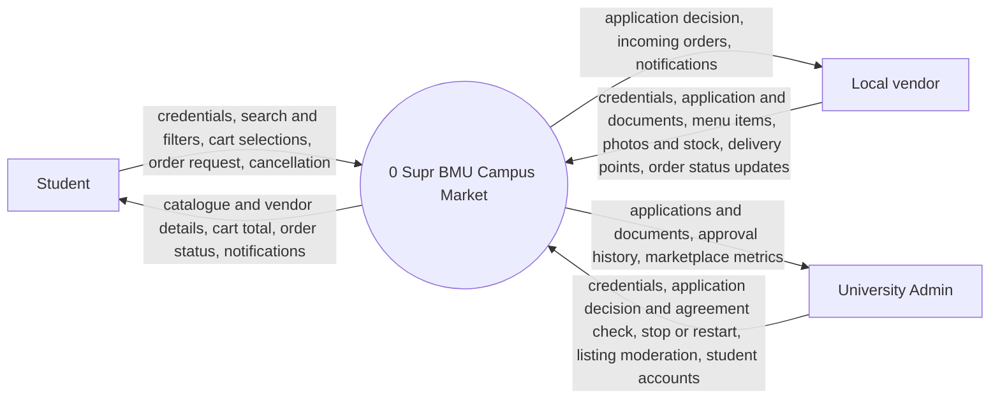
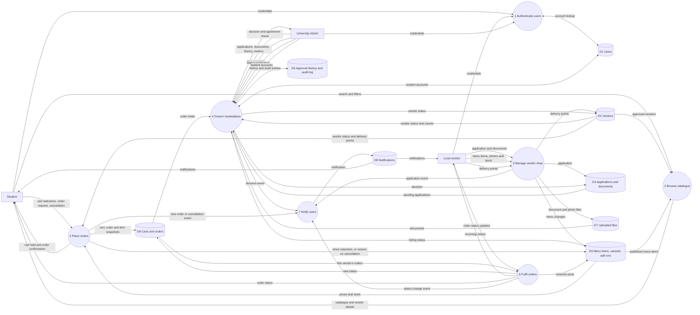
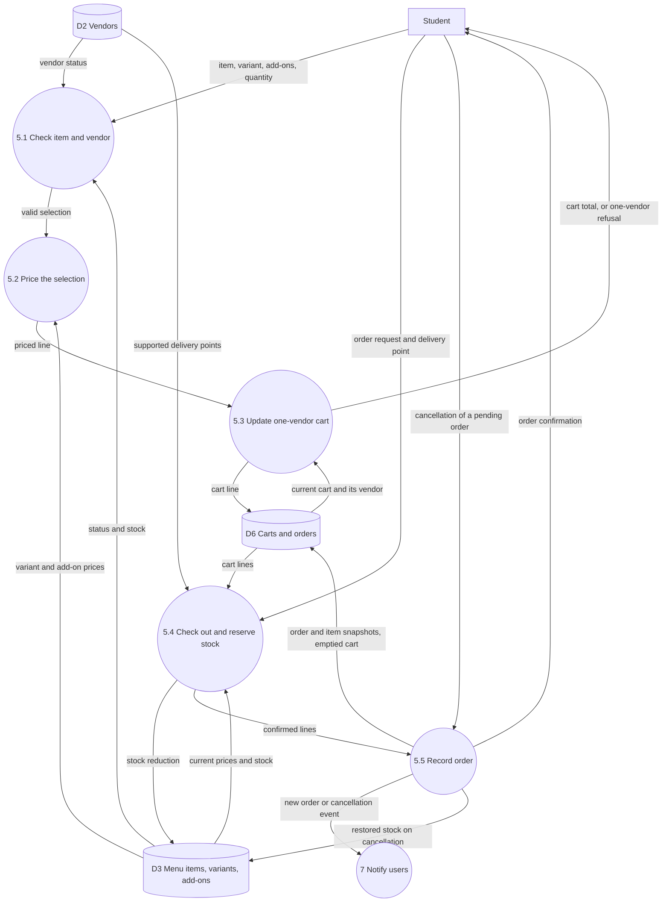
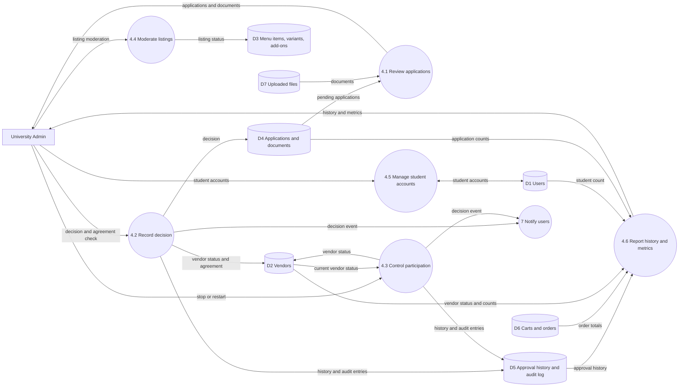

# Data flow diagrams

Data flow diagrams for Supr at three levels, as required by the CSE3005 handout: a **context diagram**, a **Level-0 DFD** that splits the system into its major processes, and **Level-1 DFDs** that break two of those processes down further. They are traced from the implemented API (`backend/app/main.py`) and data model (see [`ER.md`](ER.md)), state on 2026-11-17.

**Notation** (Mermaid has no dedicated DFD shapes, so these are used consistently):

| Symbol | Meaning |
|---|---|
| Rectangle | External entity (a person outside the system) |
| Circle | Process, numbered |
| Cylinder | Data store, labelled D1–D8 |
| Labelled arrow | Data flow |

**Balancing:** every data flow between an external entity and Supr in the context diagram appears in the Level-0 diagram, and every flow into or out of processes 4 and 5 in Level 0 appears in their Level-1 diagrams.

## Context diagram

The whole system is one process. Payment, couriers and email are outside scope, so the only external entities are the three user roles.

## Level-0 DFD

The system split into its seven main processes and eight data stores.

Level 0 has around 50 labelled flows, so it renders large. Open the rendered SVG and zoom in, or export it from mermaid.live as SVG for print.

## Level-1 DFD: process 5, Place orders

How a cart becomes an order. The one-vendor rule and server-side pricing sit in 5.1 and 5.2; 5.4 reduces stock only if enough remains, so two students cannot buy the same last item.

## Level-1 DFD: process 4, Govern marketplace

The University Admin's governance work. Every decision and participation change is written to D5, which provides the approval history.

