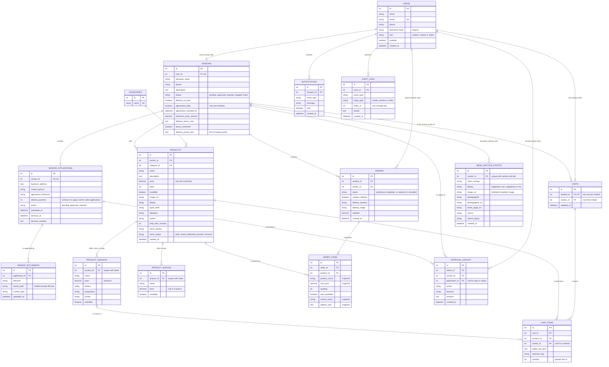

# Entity-relationship diagram

The complete Supr database schema: all 15 tables in `backend/app/models.py`, checked column by column against the live database (`backend/supr.db`, Alembic migrations 0001–0010) on 2026-11-17. Table names match the database; `alembic_version` is Alembic's bookkeeping table and is omitted.

**Notation:** crow's-foot cardinality. `||` exactly one, `o|` zero or one, `o{` zero or more, `|{` one or more. `PK` primary key, `FK` foreign key, `UK` unique.

## Design notes

- **One table for all roles.** `USERS.role` distinguishes students, vendors and admins. A vendor user owns exactly one `VENDORS` row; students own a cart and orders; admins write approval history. The diagram labels each relationship with the role it applies to.
- **One-vendor cart.** `CARTS.vendor_id` holds the vendor of the items currently in the cart, which is how the one-vendor rule (FR-07) is enforced. It is null when the cart is empty.
- **Order snapshots.** `ORDER_ITEMS` copies the product name, unit price, variant name and add-on names at checkout, so later menu or price changes never alter a past order (FR-08).
- **Deliberate denormalisation.** Three columns store small JSON lists instead of separate tables: `VENDORS.delivery_points_json`, `CART_ITEMS.addon_ids_json` and `ORDER_ITEMS.addons_json`. The add-on IDs in a cart line are therefore not enforced by a foreign key; the API re-validates them against `PRODUCT_ADDONS` on every cart read and at checkout.
- **Illustrative section photos.** `MENU_SECTION_PHOTOS` holds one stock photo per vendor menu section (two for sections that mix vegetarian and non-vegetarian items, so a vegetarian item never shows meat), matched to products by `menu_section` text rather than a foreign key. The API shows it only when the product has no `image_url` of its own, and returns it marked as illustrative with the photographer's credit.
- **Polymorphic audit log.** `AUDIT_LOGS.entity_type` plus `entity_id` can point at a vendor, product or order, so `entity_id` has no foreign-key constraint.
- **Database constraints** beyond keys: one cart per student; variant and add-on names unique within a product; variant prices at least 0; add-on prices null or at least 0; cart quantities greater than 0; one cart line per product, variant and add-on combination.
