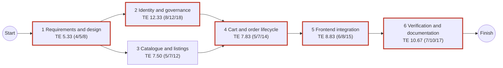

# PERT network

Activities and estimates come from [`../PROJECT_PLAN.md`](../PROJECT_PLAN.md). `TE = (O + 4M + P) / 6`, in working days. Each node shows its expected time (TE) and the optimistic / most likely / pessimistic values.

Red outlined nodes are the critical path.

## Critical path

Requirements and design → Identity and governance → Cart and orders → Frontend integration → Verification and documentation.

| Quantity | Value |
|---|---:|
| Expected duration (sum of TE on the critical path) | 5.33 + 12.33 + 7.83 + 8.83 + 10.67 = **45.0 days** |
| Variance (sum of ((P − O) / 6)² on the path) | 0.44 + 2.78 + 2.25 + 2.25 + 2.78 = **10.5** |
| Standard deviation | **3.24 days** |

Catalogue and listings (TE 7.50) runs in parallel with Identity and governance (TE 12.33), so it has about 4.8 days of slack and does not move the finish date unless it grows past 12.33 days.

Using the normal approximation PERT relies on, roughly 68% of outcomes fall between 41.8 and 48.2 days and about 95% between 38.5 and 51.5 days. The CPM table in the project plan gives 46 days because it uses single fixed durations; the two views agree within one standard deviation.

These values are planning estimates, not measured data. [`../PROJECT_TRACKING.md`](../PROJECT_TRACKING.md) is where observed durations are recorded for comparison.
