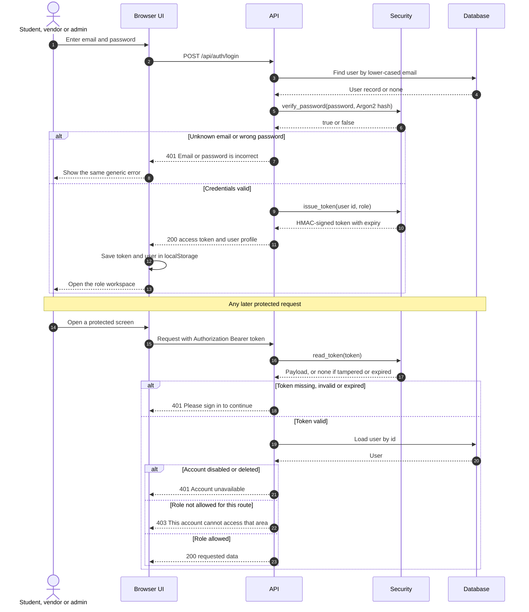
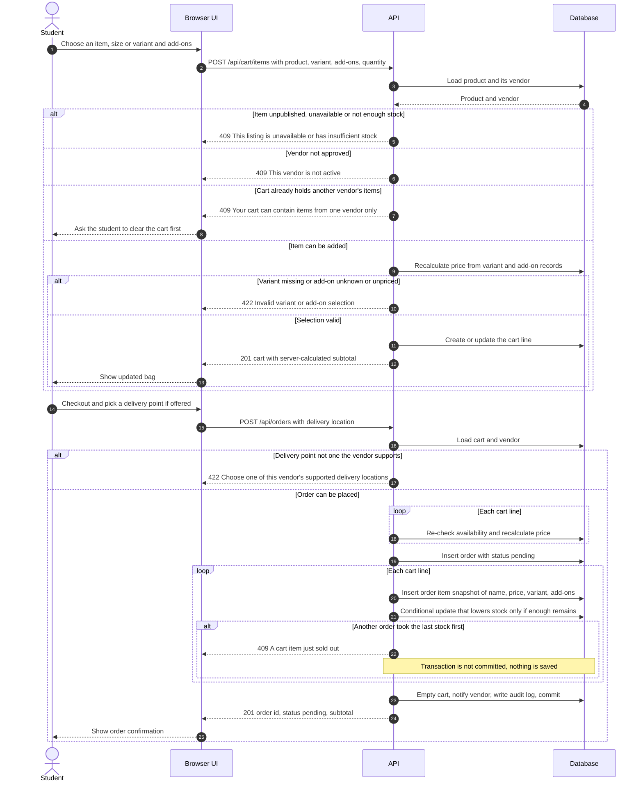
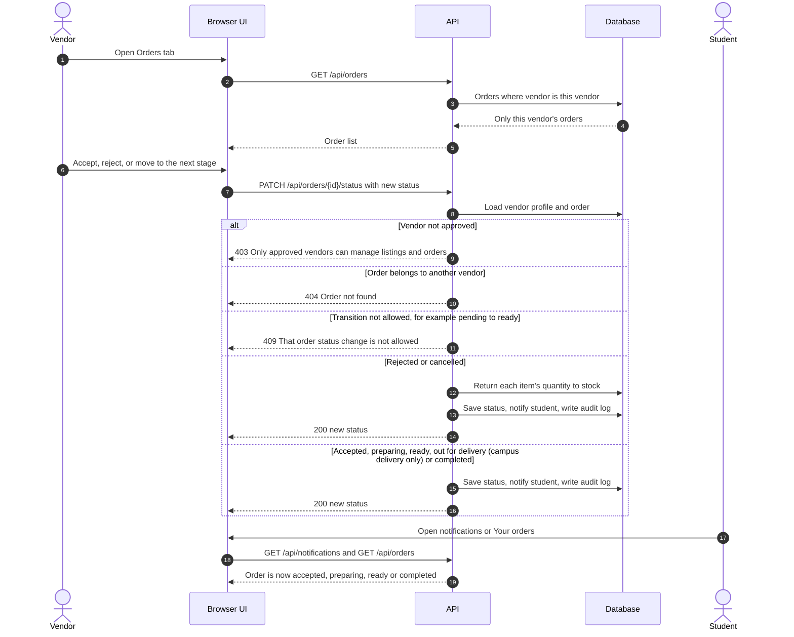
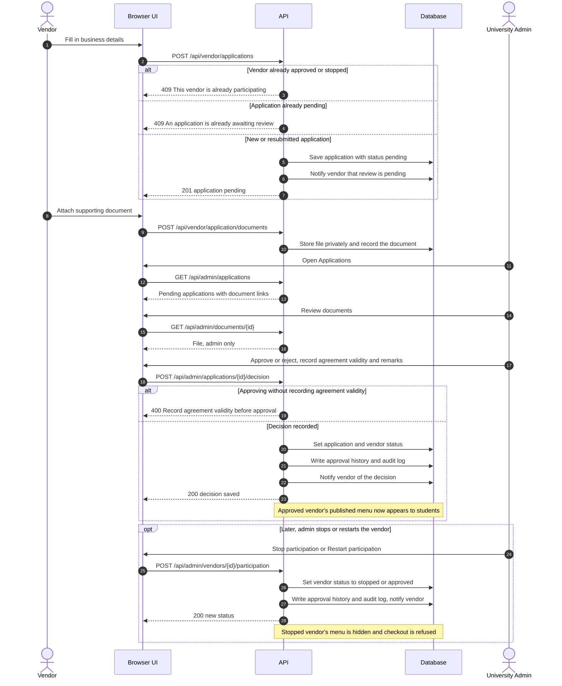

# Sequence diagrams

These UML sequence diagrams trace the main Supr interactions as implemented in `backend/app/main.py`, `backend/app/security.py` and `frontend/src/App.tsx` (state on 2026-11-17). Messages name the real API routes; error replies show the HTTP status the API returns.

Participants used throughout:

- **Browser UI**: the React single-page app (`App.tsx`).
- **API**: the FastAPI application (`main.py`), including the `current_user` / `allow(role)` dependencies.
- **Security**: token and password helpers (`security.py`).
- **Database**: SQLAlchemy models over SQLite (PostgreSQL via `DATABASE_URL`).

## 1. Sign-in and role-checked request

Covers FR-01 and NFR-01. Every protected route repeats the token and role check shown in the second half.

## 2. Student places an order

Covers FR-07, FR-08 and NFR-02. Prices are always recalculated on the server, and the cart is limited to one vendor.

## 3. Vendor fulfils an order

Covers FR-09 and FR-11. The API only allows the transitions listed in `update_order_status`.

## 4. Vendor application, admin approval and participation control

Covers FR-04, FR-05, FR-10, FR-13 and NFR-05. A vendor's menu is visible to students only while the vendor's status is approved.

